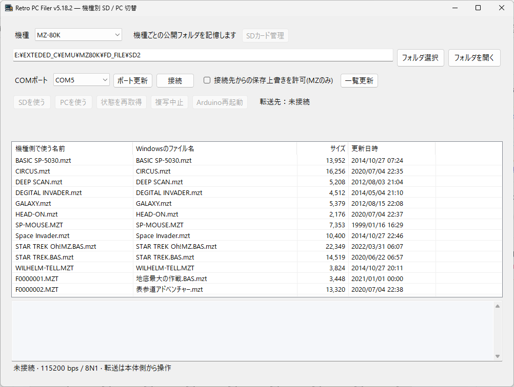
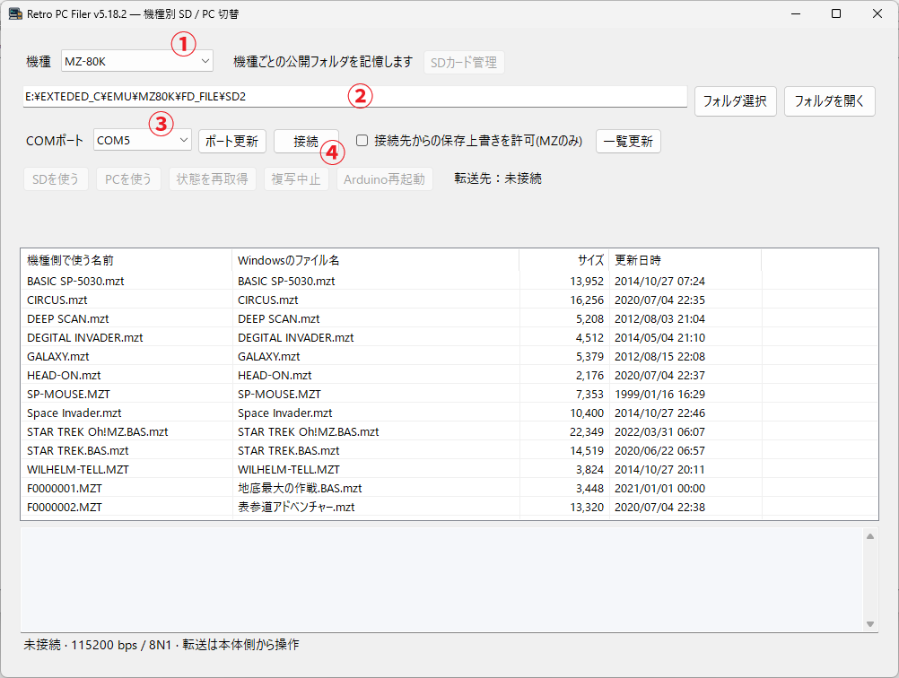
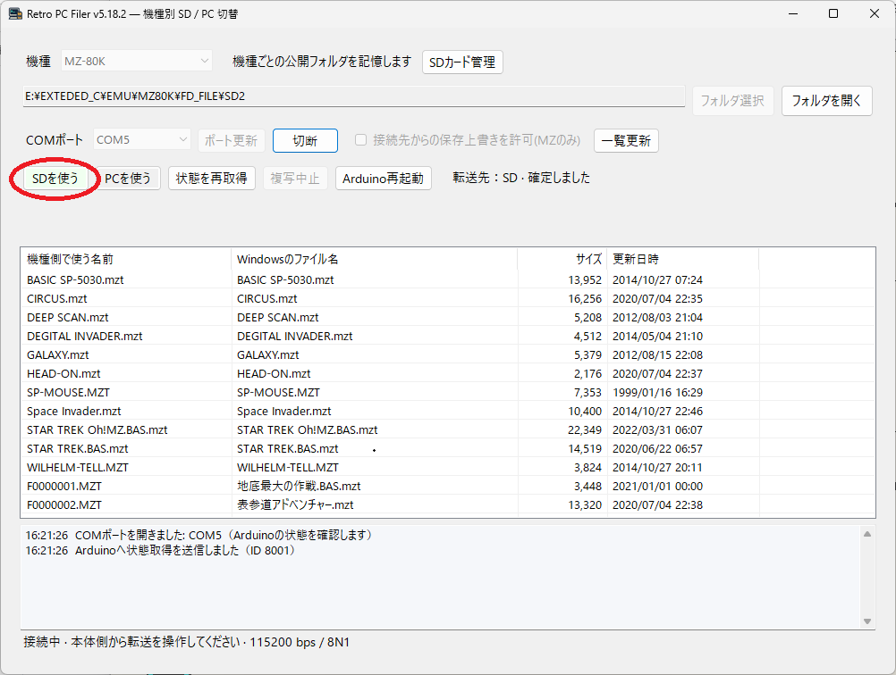
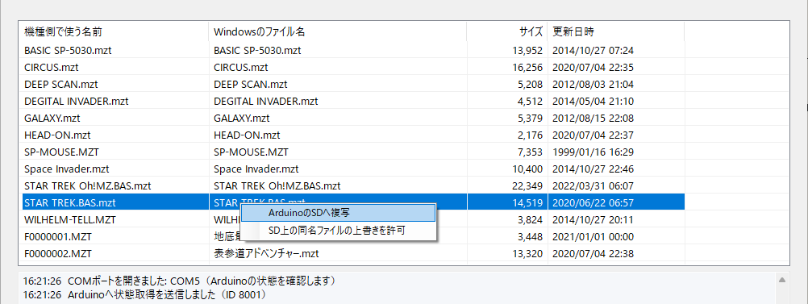
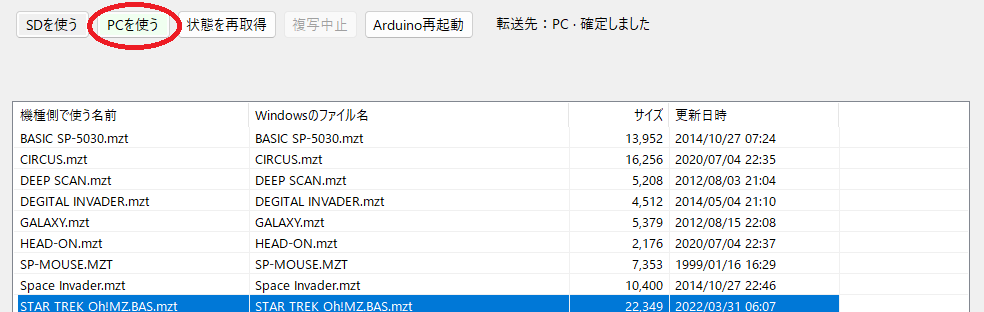
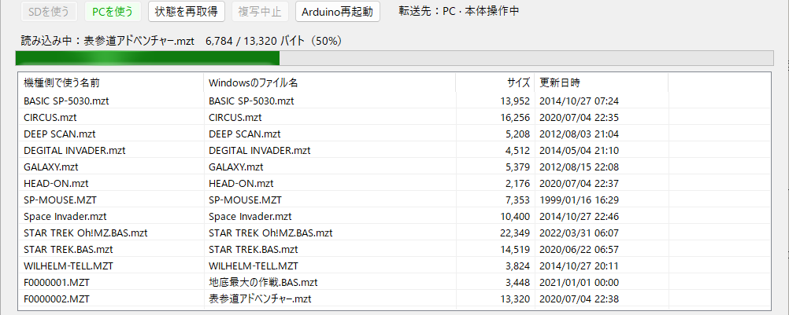

# RetroPcFiler

　今まで開発してきたxx_SDをWindowsPCから操作するユーティリティです。

#### 　現在MZ-80K用(MZ-80K、MZ-700、MZ-1500、MZ-80B、MZ-2000)、PC-8001用(PC-8001、PC-8001mk2)、FM-7用(FM-7、FM-8)を公開しています。Arduinoプログラムの検証が済み次第、対応機種を追加します。

　基本機能として以下のことが出来ます。

　1 WindowsPCのフォルダをSDの代わりに扱かう

　2 WindowsPCのファイルをSDにコピー

　3 SD内ファイル一覧取得(サブフォルダ対応、名前順にソート可)

　　1) SD内ファイルをWindowsPCフォルダへコピー(サブフォルダ対応)

　　2) SD内ファイル削除(サブフォルダ対応)

　　3) SD内ファイルコピー(サブフォルダ対応)

　　4) SD内ファイル移動(サブフォルダ対応)

　　5) サブフォルダ新規作成

　また、FM-7、PC-8001用はファイルをダブルクリックすることで読み込むファイルとしてセットできる機能があります。

　FM-7/FM-8はSDIRの代わりに使えます。

　PC-8001/PC-8001mk2はFILES又はFの代わりに使えます。

## Arduinoの書き換え
　Arduinoフォルダにある機種別のinoファイルを使って各機種のArduinoを書き換えてください。

　MZ、PC、FM実機用のプログラムに変更はありませんのでROMを書き換える必要はありません。

　なお、MZ-80K用ArduinoプログラムはAruino Pro Miniの容量を超過したため、FDのみでDOSファイル名「0000.MZT」をLOAD及び実行機能、FDA、FDC、FDR、FDD、FDPコマンドを削除しています。

## WindowsPC用プログラム
　RetroPcFilerをWindowsPcの好きなフォルダにコピーしてください。

　各機種用にWindowsPCの対象フォルダを設定することが出来ます。

　Arduinoプログラムが兼用の機種(MZ-80K、MZ-700、MZ-1500、MZ-80B、MZ-2000など)がRetroPcFilerの機種として別扱いなのはそれぞれ別のフォルダを対象と出来るようにです。

## ArduinoとWindowsPCの接続
　Arduino書込用に使用するUSB-TTLシリアルコンバーターを使って接続しますが、USB-TTLシリアルコンバーターからArduinoへの電源供給は絶対にしないでください。故障の原因になります。

　Arduinoへの電源供給をしないように出来るコンバータを使用またはVccを接続しないように工夫してください。

## 使い方

　RetroPcFilerを起動し、まず機種を選択(①)します。必要があればWindowsPCのフォルダを設定(②)します。以前設定したフォルダは記憶しています。

　xx_SDが当該機種で使えるようにセットできたらArduino、USB-TTLシリアルコンバーター、WindowsPCを接続します。くどいようですが、USB-TTLシリアルコンバーターからはArduinoに電源供給しないようにしてください。

　COMポートを選択(③)し、接続(④)をクリックします。

　正常に接続できると「SDを使う」ボタンが薄緑色になります。

　この状態の時、実機でのxx_SDの機能は今までと同じに使えます。

　もし、正常に接続できなかった場合は、すべての電源を切り、再試行してください。

### 「SDを使う」の時のファイルリスト
　ファイルリストに表示されているのは各機種ごとに設定されたWindowsPCのフォルダに存在するその機種で使える拡張子のファイルです。SDカードの内容ではありません。

　ファイルを右クリックするとポップアップメニューが出ますので当該ファイルをSDカードにコピーすることが出来ます。

　もし、ファイル名にアスキー文字以外が含まれている場合、ファイル名が32文字以上の場合にはリストの１列目に書かれている「Fxxxxxxx」というファイル名に変換してコピーします。

### 「PCを使う」の時のファイルリスト
　「PCを使う」ボタンをクリックしてください。見た目に変化はありませんが、実機からのxx_SDへのコマンドの対象がSDカードからWindowsPCのフォルダに切り替わっています。

　WindowsPC上のファイルをSDにコピーしてxx_SDにSDカードをセットするという手間をかけずにWindowsPC上のファイルを直に実機で使えるようになります。

　この時も、ファイル名にアスキー文字以外が含まれている場合、ファイル名が32文字以上の場合にはリストの１列目に書かれている「Fxxxxxxx」というファイル名が実機からアクセスできるファイル名になります。

　実機からWindowsPC上のファイルをLOADした場合、バーグラフで進捗状況が表示されます。

　